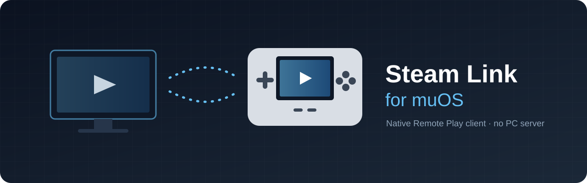
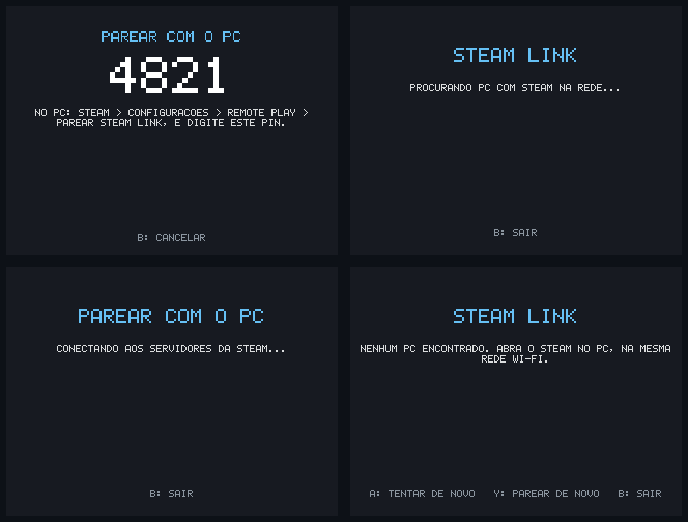

<div align="center">



<br>

**Language:** **English** | [Português (Brasil)](README.pt-BR.md)

<br>

[](https://github.com/JoaoGabrielSantosFranco/steamlink-muos/releases)
[](https://github.com/JoaoGabrielSantosFranco/steamlink-muos/releases)
[](https://github.com/JoaoGabrielSantosFranco/steamlink-muos/stargazers)
[](LICENSE)


</div>

> [!WARNING]
> **Experimental.** Streaming (H.264 at 60 fps, Opus audio and controls) has been tested on a real
> RG40XXH. On-device pairing is new and still being validated. Reports and logs are very welcome.

<div align="center">

<table>
<tr>
<td align="center" width="33%">
<a href="https://github.com/JoaoGabrielSantosFranco/steamlink-muos/releases/latest"><b>Download</b></a><br>
<sub>Latest <code>SteamLink-muOS.zip</code></sub>
</td>
<td align="center" width="33%">
<a href="#install"><b>Install</b></a><br>
<sub>Unzip, open, type a PIN</sub>
</td>
<td align="center" width="33%">
<a href="docs/PROTOCOLO.md"><b>Protocol notes</b></a><br>
<sub>How Remote Play works on the wire</sub>
</td>
</tr>
</table>

[Jump to install ↓](#install)

</div>

---

# Steam Link for muOS

**Play your PC's Steam library on a muOS handheld, using nothing but Steam on the PC.**

A native Steam Link client written in C, built by reverse engineering Steam's own Remote Play protocol.
No Sunshine, no Moonlight, no companion app, and no PC needed to set it up.

```
unzip -> open the app -> type the PIN into Steam -> play
```

> The handheld becomes just another Steam Link. Steam does the rest.

| | |
|---|---|
| **Target device** | Anbernic RG40XXH (other H700 muOS devices expected to work) |
| **Video** | H.264, up to 60 fps, letterboxed to the screen |
| **Audio** | Opus, 48 kHz stereo, low latency |
| **Input** | Seen by the PC as an Xbox 360 controller |
| **Pairing** | On the device, with a 4-digit PIN |
| **Footprint** | One ~4.7 MB ARM64 binary; needs only muOS's SDL2 and glibc ≥ 2.29 |

## Screenshots

<div align="center">



<sub>Real app screens at the RG40XXH's 640×480: pairing PIN, PC search, connecting to Steam, and an error
screen with its button hints. The PIN shown is an example.</sub>

</div>

## Why this exists

| | Moonlight + Sunshine | **Steam Link for muOS** |
|---|---|---|
| Software on the PC | Sunshine, installed and configured | **Steam only** |
| Pairing | PIN in Sunshine's web UI on the PC | **PIN typed into Steam** |
| Where you land | Apps configured in Sunshine | **Steam Big Picture** |
| Hardware decoding | Depends on the port | Not yet (CPU decode) |

If you already live in Steam and just want your handheld to show up as a Steam Link, this is for you.

---

<a id="install"></a>

## Install

### Requirements

| Where | What you need |
|---|---|
| **PC** | Steam running and signed in, with **Remote Play enabled** (*Steam → Settings → Remote Play*). Same local network as the handheld. Windows unlocked (Steam doesn't stream the lock screen or UAC prompts). |
| **Handheld** | muOS with Wi-Fi connected. **Internet is needed for the first pairing only**, since the PIN comes from Steam's servers. Streaming itself stays on your LAN. |

### 1. Copy the app to the SD card

Download `SteamLink-muOS.zip` from [**Releases**](https://github.com/JoaoGabrielSantosFranco/steamlink-muos/releases/latest)
and extract it to the **root** of the muOS SD card:

```
MUOS/application/Steam Link/
├── mux_launch.sh        muOS launcher
├── mux_lang.ini
├── glyph/steamlink.png
├── cacert.pem           CA bundle for talking to Steam securely
└── steamlink            the client
```

### 2. Pair (first launch only)

1. On the handheld, open **Applications → Steam Link**. A 4-digit **PIN** appears.
2. On the PC, open *Steam → Settings → Remote Play → **Pair Steam Link*** and type the PIN.
3. The handheld shows *"Pareado!"* ("Paired!") and stores its key in `device.json` next to the app.

> [!CAUTION]
> `device.json` is your device's key. Never share it. Delete it to pair again from scratch.

### 3. Play

The app finds your PC, connects and opens Big Picture. Later launches go straight to streaming.

## Controls

| Action | Button |
|---|---|
| In-game input | Every button, as an Xbox 360 controller |
| Steam menu | **MENU** |
| Quit while streaming | Hold **SELECT + START** for ~1 s |
| Quit while pairing, searching or connecting | **B** (or **SELECT**) |
| Error screens | **A** retry · **Y** pair again · **B** quit |

The layout follows muOS's own controller settings ("retro"/"modern"). If muOS doesn't provide a mapping,
the app falls back to the standard "muOS-Keys" layout.

> [!NOTE]
> On-screen text is currently in Brazilian Portuguese. An English UI is on the roadmap.

## Supported devices

| Device | Status |
|---|---|
| Anbernic RG40XXH | **Tested** on hardware |
| RG35XX Plus / H / SP / 2024, RG40XX V, RG CubeXX, RG34XX, RG28XX (H700, muOS) | Expected to work, untested |
| Other ARM64 muOS devices (TrimUI, Rockchip) | May work; video performance not evaluated |

Video is decoded on the CPU with FFmpeg. 640×480 at 60 fps fits comfortably on the H700; weaker chips may
stutter. Tested another device? Open an issue with your `steamlink.log` and it goes in the table.

<details>
<summary><b>Configuration</b></summary>

<br>

`device.json` accepts optional fields next to the ones written by pairing:

| Field | Default | Description |
|---|---|---|
| `host` | auto-discovery | Fixed PC IP address, e.g. `"192.168.0.10"` |
| `width`, `height` | `640`, `480` | Resolution requested from the PC |
| `fps` | `60` | Frame rate requested from the PC |
| `bitrate_kbps` | `10000` | Video bitrate requested from the PC |

```json
{
  "device_id": 1234567890123456789,
  "secret": "…",
  "steamid": 76561190000000000,
  "host": "192.168.0.10",
  "bitrate_kbps": 8000
}
```

</details>

<details>
<summary><b>Troubleshooting</b></summary>

<br>

Logs live in `MUOS/application/Steam Link/steamlink.log` and `steamlink.stderr.log`.

| On-screen message / symptom | Likely cause and fix |
|---|---|
| *"Sem acesso a internet"* or *"Nenhum servidor da Steam respondeu"* while pairing | The handheld needs internet to get a PIN. Check Wi-Fi. |
| *"Certificado de … rejeitado"* while pairing | `cacert.pem` is missing from the app folder. Extract the zip again. |
| *"Tempo esgotado"* while pairing | The PIN wasn't entered on the PC within 10 minutes. Try again. |
| *"Nenhum PC encontrado"* | Steam is closed, the PC is on another network, or a firewall blocks Steam. Try setting `host`. |
| *"PC recusou: dispositivo nao autorizado"* | The pairing was removed in Steam. Press **Y** to pair again. |
| Black video with a yellow warning | The PC is on the Windows lock screen or a UAC prompt. Unlock it. |
| Choppy video | Weak Wi-Fi. Lower `bitrate_kbps` or move closer to the router. |
| App closes right after launch | Open an issue and attach `steamlink.stderr.log`. |

</details>

<details>
<summary><b>Building from source</b></summary>

<br>

The build runs in Docker (Debian bullseye, glibc 2.31) with an ARM64 cross-compiler, a minimal static
FFmpeg (H.264 and Opus only) and static OpenSSL. SDL2 is linked dynamically against the device's copy.

```sh
docker build -t steamlink-build client/docker          # once (builds FFmpeg)
make -C client docker                                  # -> client/build/aarch64/steamlink
make -C client package                                 # -> client/dist/ + SteamLink-muOS.zip
make -C client package CREDENTIALS=state/device.json   # same, bundling your key (personal use only)
```

An x86_64 build runs headless on a desktop, decoding the stream and printing statistics:

```sh
make -C client docker ARCH=x86_64
docker run --rm --network host \
  -v "$PWD/client":/work -v "$PWD/state/device.json":/cfg/device.json:ro \
  steamlink-build ./build/x86_64/steamlink --headless --host <pc-ip> --config /cfg/device.json --seconds 20
```

| Option | Description |
|---|---|
| `--host IP` | Connect to this PC instead of discovering one |
| `--config FILE` | Path to `device.json` |
| `--log FILE` | Log file path |
| `--headless` | No window; decode only and print stats |
| `--seconds N` | Stop after N seconds |
| `--dump FILE.pgm` | Save a decoded frame |
| `--h264 FILE.h264` | Save the raw video stream |

</details>

<details>
<summary><b>How it works</b></summary>

<br>

```
 handheld                               PC (Steam)                    Steam CM servers
    |                                       |                                |
    |---- pairing over WebSocket (first launch only) ----------------------->|
    |<--- PIN ---------------------------------------------------------------|
    |                                       |<---- PIN typed, key relayed ---|
    |---- discovery / stream request ------>|  UDP 27036
    |<--- port + encrypted session key -----|
    |==== UDP session: MTU ping, handshake, AES-CBC control ===============|
    |<=== H.264 video + Opus audio =========|
    |==== remote HID (Xbox 360 pad) =======>|
```

1. **Pairing** goes through Steam's CM servers over WebSocket. They issue the PIN and relay an
   X25519 key exchange to the PC, so nothing has to be copied from the PC.
2. **Discovery and stream request** on UDP 27036 (`CMsgRemoteClientBroadcast*`), proving possession of
   the device key. The PC answers with a port and an encrypted session key.
3. **UDP session** with a 13-byte header + CRC32C, plus reliable and unreliable channels.
4. **MTU ping** (type-0 packets) before the handshake, HMAC-SHA256 authentication, and AES-CBC-encrypted
   control messages.
5. **Negotiation** of codecs, **media** on the data channels, and **input** through Steam's remote HID as
   a virtual SDL gamepad.

Full protocol notes, reverse engineered from the official Steam Link for Raspberry Pi, are in
[`docs/PROTOCOLO.md`](docs/PROTOCOLO.md) (Portuguese).

</details>

<details>
<summary><b>Project layout</b></summary>

<br>

```
client/src/       C client: session, discovery, pairing, TLS/WebSocket, crypto, protobuf, FFmpeg, SDL
client/muos/      muOS launcher and icon
client/docker/    build environment
tools/proto/      Python prototypes (pairing, streaming)
tools/            discovery and reverse-engineering helpers
re/protos, re/pb  Steam protobuf definitions used by the tools
docs/             protocol documentation
```

</details>

## Roadmap

- [x] H.264 + Opus streaming at 60 fps
- [x] Remote HID controller (Xbox 360)
- [x] On-device PIN pairing
- [x] Quit from every screen
- [ ] Hardware video decoding (H700 VPU)
- [ ] Request the handheld's native resolution automatically
- [ ] English UI
- [ ] Validation on more muOS devices

## Contributing

Bug reports, device test results and pull requests are welcome. When reporting a problem, please attach
`steamlink.log` and `steamlink.stderr.log` from the app folder.

> [!IMPORTANT]
> Logs don't include your key, but **never attach `device.json`** to an issue.

## Credits

- [ihslib](https://github.com/mariotaku/ihslib) by Mariotaku: reference for the MTU ping, video frame
  format and remote HID.
- [Thalium](https://blog.thalium.re/posts/achieving-remote-code-execution-in-steam-remote-play/) and the
  SSTIC 2023 paper on the Remote Play protocol.
- [SteamDatabase/Protobufs](https://github.com/SteamDatabase/Protobufs) and
  [GameNetworkingSockets](https://github.com/ValveSoftware/GameNetworkingSockets).
- The [muOS](https://muos.dev) team for the OS and its application model.

## Star history

<a href="https://star-history.com/#JoaoGabrielSantosFranco/steamlink-muos&Date">
  <picture>
    <source media="(prefers-color-scheme: dark)" srcset="https://api.star-history.com/svg?repos=JoaoGabrielSantosFranco/steamlink-muos&type=Date&theme=dark">
    
  </picture>
</a>

## License and disclaimer

Released under the [MIT License](LICENSE).

This is an independent project, not affiliated with or endorsed by Valve. Steam and Steam Link are
trademarks of Valve Corporation. The reverse engineering was done for interoperability and personal use;
this repository contains no Valve binaries or proprietary code.
